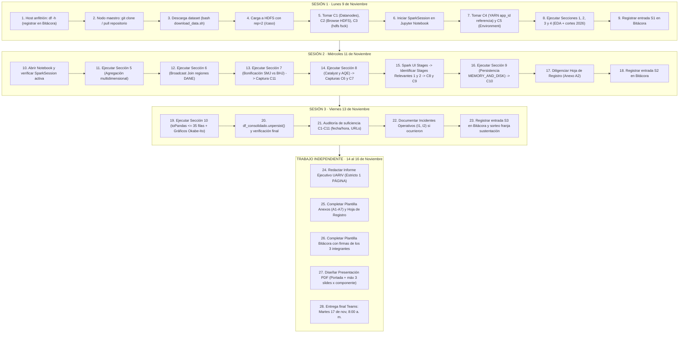

# Guía y Plan de Acción Maestro para Trabajo en el Clúster
## Caso de Estudio: Big Data (2026-II) · Universidad Externado de Colombia
**Equipo MABD01:**  
- **Julián Steven Duarte Gómez** — Componente A: *Datos y Almacenamiento*  
- **Julián Camilo Jiménez Rodríguez** — Componente B: *Procesamiento*  
- **Juan Tomás Rincón Pinzón** — Componente C: *Desempeño y Resultados*  
- **Equipo Conjunto** — Componente D: *Redacción, Anexos, Bitácora y Sustentación*  

**Entidad Contratante (Cliente):** Unidad para la Atención y Reparación Integral a las Víctimas (**UARIV**)  
**Dataset Oficial:** *Cifras de Víctimas por Hechos – Municipal* (`datos.gov.co` ID: `9qih-4vkc`)  
**Dimensiones Confirmadas:** 11.121.064 filas · 19 columnas · 3.330.779.150 bytes (3,33 GB / 3,10 GiB) · CSV UTF-8  
**Repositorio GitHub:** [TomasRincon18/Caso-BigData-UARIV-Victimas](https://github.com/TomasRincon18/Caso-BigData-UARIV-Victimas.git)  

---

## 0. Reglas de Oro y Criterios de Suficiencia Obligatorios (Pág. 9 del PDF)

> [!CAUTION]
> **Criterios de Suficiencia para que una captura NO sea anulada:**
> 1. **Fecha y hora del sistema visibles** en **todas** las capturas sin excepción (barra de tareas del anfitrión o comando `date`).
> 2. **Capturas de Spark UI (C5, C7, C8, C9, C10, C11):** Debe verse obligatoriamente la **barra de direcciones del navegador** mostrando la URL completa con el identificador `application_<timestamp>_<id>`. Esto acredita que la ejecución es propia del equipo.
> 3. **Capturas de Jupyter Notebook (C6, C11):** Debe verse la **celda completa** (código ejecutable + salida textual íntegra).
> 4. **Captura de terminal Linux (C3):** Debe verse el comando completo ejecutado junto con el prompt del usuario `hadoop@...:~$`.
> 5. **Interpretación obligatoria:** En la plantilla Word de Anexos, cada captura debe ir acompañada de un párrafo de **2 a 4 líneas** explicando técnicamente lo que muestra.
> 6. **Solo las capturas solicitadas:** No agregar capturas extra en A1 (no dan puntos). Los incidentes van en A4 numerados como I1, I2...

---

## 1. Asignación de Roles y Componentes para la Sustentación Oral

La sustentación oral (Miércoles 18 de nov, 7:00 a 11:00 a. m.) dura **18,5 minutos** (1 min sorteo + 9 min exposición [3 min/persona] + 7,5 min preguntas [2,5 min/persona] + 1 min cierre). La docente sortea quién expone cada componente (A, B o C), y luego hace **dos preguntas individuales**: una sobre el componente propio y otra sobre un componente ajeno.

| Componente | Integrante Responsable | Alcance Técnico para la Sustentación | Preguntas Típicas de la Docente |
| :--- | :--- | :--- | :--- |
| **A. Datos y Almacenamiento** | **Julián Steven Duarte Gómez** | Justificación del dataset UARIV, ingesta a HDFS en `/caso`, factor de replicación 2, cálculo y distribución de bloques en DataNodes (`hdfs fsck`), verificación de espacio en disco anfitrión (`df -h`). | • ¿Por qué replicación 2 y no 3? *(El clúster tiene 2 workers físicos; replicación 3 generaría un bloque sub-replicado constante).*<br>• ¿Cómo se distribuyeron los bloques entre los dos DataNodes? *(Mostrar C3).* |
| **B. Procesamiento** | **Julián Camilo Jiménez Rodríguez** | Configuración de SparkSession en YARN, justificación de memoria/cores y particiones (8), omisión técnica de `inferSchema=True`, transformaciones complejas (agregación de eventos/declarantes/ubicados y tasa de efectividad), Broadcast Join con regiones DANE, Catalyst y AQE (`isFinalPlan=false` vs `true`). | • ¿Por qué no usar `inferSchema=True`? *(Exige un escaneo completo inicial de 3,33 GB en HDFS duplicando el I/O).*<br>• ¿Por qué el plan inicial muestra `isFinalPlan=false`? *(AQE pospone la optimización física final hasta recolectar estadísticas reales de shuffle en tiempo de ejecución).* |
| **C. Desempeño y Resultados** | **Juan Tomás Rincón Pinzón** | Análisis de la Spark UI, identificación de los 2 stages relevantes (duración, tareas, shuffle write/read, spill), política de cache `MEMORY_AND_DISK` con `.unpersist()`, bonificación SMJ vs. BHJ (reducción a cero de shuffle de la tabla grande), visualización con patrón Big Data ($\le 35$ filas $\rightarrow$ `.toPandas()`), formato `fmt_co`, recomendación Cloud (BigQuery) vs On-Premise. | • ¿Por qué eligió esos dos stages como relevantes? *(Criterio b: mayor volumen de shuffle write en la agregación; Criterio a: mayor duración por ordenamiento/red).*<br>• ¿Por qué persistió el DataFrame y cómo verificó la memoria? *(Se usó en dos acciones consecutivas; 100% cached en Storage UI).* |
| **D. Redacción y Consolidación** | **Equipo Conjunto** | Informe de consultoría ejecutiva (máx. 1 página), diapositivas de sustentación (portada + máx. 3 diapositivas por componente), anexos completos y bitácora con firmas. | • Coherencia entre lo reportado en el informe, las métricas de la hoja de registro y la bitácora. |

---

## 2. Cronograma de Ejecución Paso a Paso en el Clúster



---

## 3. Guía Detallada de Comandos y Celdas por Sesión

### Sesión 1: Lunes 9 de noviembre (Almacenamiento, Setup y EDA)

#### Paso 1.1: Verificación de espacio en el equipo anfitrión (Pre-requisito Bitácora)
En la **terminal del equipo físico anfitrión** (antes de entrar a las VMs o en paralelo):
```bash
# Ejecutar y anotar valor exacto para la Bitácora (Pág. 2 del PDF):
df -h
```
*Anotar fecha, hora y espacio disponible (ej. `/dev/sda1 ... 45G disponible`).*

#### Paso 1.2: Clonar o actualizar el repositorio en el nodo maestro
En la terminal del nodo maestro con el usuario `hadoop`:
```bash
cd ~
# Si ya existe, hacer pull; si no, clonar:
if [ -d "Caso-BigData-UARIV-Victimas" ]; then
    cd Caso-BigData-UARIV-Victimas && git pull origin master
else
    git clone https://github.com/TomasRincon18/Caso-BigData-UARIV-Victimas.git
    cd Caso-BigData-UARIV-Victimas
fi
```

#### Paso 1.3: Descargar el dataset completo (3,33 GB)
Ejecutar el script optimizado de descarga:
```bash
bash download_data.sh
```
*Tarda ~1 minuto con el respaldo de Google Drive CDN. Verifica que la salida reporte exactamente `3330779150 bytes`.*

#### Paso 1.4: Ingesta en HDFS con Factor de Replicación 2
```bash
# 1. Crear directorio en HDFS si no existe
hdfs dfs -mkdir -p /caso

# 2. Cargar archivo con factor de replicación 2 explícito
hdfs dfs -Ddfs.replication=2 -put -f data/victimas_uariv.csv /caso/

# 3. Validar tamaño y replicación (debe decir '2' en la 2da columna)
hdfs dfs -ls /caso/victimas_uariv.csv

# 4. Inspección profunda de bloques y ubicaciones en DataNodes
hdfs fsck /caso/victimas_uariv.csv -files -blocks -locations
```

> [!IMPORTANT]
> **TOMA DE CAPTURAS C1, C2 Y C3 (Componente A - Julián Duarte):**
> - **C1:** Abrir navegador en `http://localhost:9870` (o IP del NameNode) $\rightarrow$ pestaña **Datanodes**. Deben verse los **dos DataNodes** en estado "In service", capacidad y uso.
> - **C2:** En el portal HDFS `:9870` $\rightarrow$ menú **Utilities** $\rightarrow$ **Browse the file system** $\rightarrow$ navegar a `/caso`. Debe verse `victimas_uariv.csv`, su tamaño (`3.33 GB` o `3.10 GiB`) y **Replication = 2**.
> - **C3:** En la terminal de Linux, tomar captura de la salida de `hdfs fsck ...` mostrando el resumen final (`Total size: 3330779150 B`, `Total blocks: ~25-27`, `Average block replication: 2.0`) y la asignación de bloques a ambos DataNodes. **Debe verse el prompt `hadoop@...:~$` y la hora/fecha del sistema.**

#### Paso 1.5: Iniciar Jupyter Notebook y SparkSession
1. Iniciar Jupyter en el nodo maestro: `jupyter notebook` o acceder por el puerto configurado.
2. Abrir el notebook [`CasoBD_Duarte-Jimenez-Rincon_Notebook.ipynb`](file:///home/fabri/code/Semestre%205/BigData/caso_estudio_UARIV/CasoBD_Duarte-Jimenez-Rincon_Notebook.ipynb).
3. Ejecutar las celdas de **Imports y utilidades**.
4. Ejecutar **Sección 1 (SparkSession sobre YARN)**.

> [!IMPORTANT]
> **TOMA DE CAPTURAS C4 Y C5 (Componente B - Julián Jiménez):**
> - **C4:** Abrir el portal de YARN en `http://localhost:8088` (ResourceManager). Ubicar la fila de la aplicación en ejecución. Debe verse:
>   - `application_id`: `application_<timestamp>_0001` (o el que asigne). **¡Este es el APPLICATION_ID DE REFERENCIA del proyecto!**
>   - Usuario: `hadoop`.
>   - Nombre: `CasoBD_UARIV_Victimas`.
>   - Application Type: `SPARK`.
>   - State: `RUNNING`.
> - **C5:** Abrir la Spark UI (`http://localhost:4040` o el enlace *ApplicationMaster* desde YARN) $\rightarrow$ pestaña **Environment** $\rightarrow$ tabla **Spark Properties**. Deben verse los parámetros modificados:
>   - `spark.master`: `yarn`
>   - `spark.executor.instances`: `2`
>   - `spark.executor.cores`: `2`
>   - `spark.executor.memory`: `2g`
>   - `spark.sql.shuffle.partitions`: `8`
>   - `spark.sql.adaptive.enabled`: `true`
>   *(Asegurar que la barra de direcciones del navegador muestre la URL completa con el `application_id`).*

#### Paso 1.6: Ejecutar Secciones 2, 3 y 4 en el Notebook
- **Sección 2:** Ejecutar la definición de `schema = StructType(...)`.
- **Sección 3:** Lectura perezosa de `hdfs:///caso/victimas_uariv.csv` y verificar `df.rdd.getNumPartitions()` (anotar este valor para Anexo A2).
- **Sección 4a:** Ejecutar `df.count()` (debe arrojar exactamente **11.121.064**).
- **Sección 4b:** Verificación de nulos en columnas clave.
- **Sección 4c:** Distribución por año de corte (2024, 2025 y 2026).
- **Sección 4d:** Tabla de los 9 cortes de 2026 (filas y suma de eventos).

#### Paso 1.7: Cerrar la sesión y registrar en Bitácora
- Si no se va a seguir usando el clúster inmediatamente, se puede dejar la VM en pausa o cerrar Spark con `spark.stop()`.
- **Diligenciar Entrada S1 en la Bitácora Word:**
  - Registrar la fecha y hora.
  - Para cada integrante (Julián Duarte, Julián Jiménez, Juan Tomás Rincón): registrar actividades, evidencias (`application_id` de referencia, capturas C1 a C5) y herramientas de IA utilizadas.

---

### Sesión 2: Miércoles 11 de noviembre (Análisis Principal, Joins, AQE y Spark UI)

#### Paso 2.1: Reanudar SparkSession
Si se reinició la máquina o la sesión, ejecutar la celda de la Sección 1.
*(Nota: Si se genera un nuevo `application_id`, anotarlo en la tabla 4 de la bitácora como aplicación secundaria de la sesión 2; el de referencia sigue siendo el de la Sesión 1).*

#### Paso 2.2: Ejecutar Sección 5 (Agregación Multidimensional)
- Ejecutar la celda `S5`.
- Se agrupa por `(COD_ESTADO_DEPTO, ESTADO_DEPTO, CIUDAD_MUNICIPIO, HECHO)`.
- Se calculan `TOTAL_EVENTOS`, `TOTAL_DECLARANTES`, `TOTAL_UBICADOS` y `TASA_EFECTIVIDAD_UBICACION`.
- Anotar el número de filas resultantes antes del join (aprox. 15.000 a 25.000 filas agregadas).

#### Paso 2.3: Ejecutar Sección 6 (Broadcast Join con Tabla Satélite DANE)
- Ejecutar `S6a` (creación de `df_regiones` con los 33 departamentos DANE + código 0 'Sin Definir').
- Ejecutar `S6b` (join con `broadcast(df_regiones)`).

#### Paso 2.4: Ejecutar Sección 7 (Bonificación SMJ vs. BHJ — Req. VIII)
1. **Celda S7a (Sort Merge Join forzado):**
   - Se ejecuta con `spark.sql.autoBroadcastJoinThreshold = -1`.
   - Se mide el tiempo de ejecución y se imprime `df_smj.explain()`.
2. **Celda S7b (Broadcast Hash Join):**
   - Se restaura `spark.sql.autoBroadcastJoinThreshold = 10485760` (10 MiB).
   - Se ejecuta con `broadcast(df_regiones)` y se mide el tiempo.
3. **Celda S7c:**
   - Imprime el *Speedup* comparativo.

> [!IMPORTANT]
> **TOMA DE CAPTURA C11 (Bonificación - Juan Tomás Rincón):**
> - En el Notebook o en Spark UI pestaña **Stages**:
> - Mostrar la comparativa de ambos escenarios:
>   - **Escenario SMJ:** Plan físico con operador `SortMergeJoin` y nodos `Exchange` (shuffle en ambas tablas), con Shuffle Read/Write > 0.
>   - **Escenario BHJ:** Plan físico con operador `BroadcastHashJoin` y `BroadcastExchange` solo para la tabla pequeña, con Shuffle Read/Write = 0 para la tabla grande.
> - Si se toman capturas de Spark UI, incluir la URL con `application_id` y fecha/hora del sistema.

#### Paso 2.5: Ejecutar Sección 8 (Catalyst y AQE — Req. 5)
1. **Celda S8a:**
   - Ejecuta `consulta_principal.explain(True)`.
   - Muestra las 4 fases: Parsed Logical Plan, Analyzed Logical Plan, Optimized Logical Plan y Physical Plan.
   - **TOMA DE CAPTURA C6:** Tomar captura de la celda completa del notebook mostrando el texto `AdaptiveSparkPlan isFinalPlan=false`.
2. **Celda S8b:**
   - Ejecuta una acción que materializa la consulta (`count()` o `cache()`).
   - **TOMA DE CAPTURA C7:** Ir a la Spark UI $\rightarrow$ pestaña **SQL / DataFrame** $\rightarrow$ hacer clic en la consulta ejecutada $\rightarrow$ en la sección **Details**, capturar el plan físico final donde se lea explícitamente `AdaptiveSparkPlan isFinalPlan=true`. Verificar que se vea la barra de direcciones con el `application_id`.

#### Paso 2.6: Análisis de Stages Relevantes en Spark UI (Req. 6)
Ir a la Spark UI $\rightarrow$ pestaña **Stages**:
1. **Stage Relevante 1 (Criterio b - Mayor volumen de Shuffle Write, o d - Agregación/Join):**
   - Típicamente el Stage del `groupBy` de la Sección 5.
   - Hacer clic en el Stage ID.
   - **TOMA DE CAPTURA C8:** Capturar el **DAG Visualization** y la tabla **Summary Metrics for Completed Tasks** (Duration, Shuffle Read, Shuffle Write, Spill memory/disk).
2. **Stage Relevante 2 (Criterio a - Stage de mayor duración del job):**
   - Identificar el stage con mayor tiempo de ejecución (que no sea el stage final de recolección).
   - Hacer clic en el Stage ID.
   - **TOMA DE CAPTURA C9:** Capturar el **DAG Visualization** y la tabla **Summary Metrics** (Duration: Median y Max, Shuffle Read/Write, Spill).

#### Paso 2.7: Ejecutar Sección 9 (Persistencia y Gestión de Memoria — Req. 8)
- Ejecutar la celda `S9`: `df_consolidado = df_enriquecido.persist(StorageLevel.MEMORY_AND_DISK)`.
- Se ejecuta la **Acción 1** (`df_consolidado.count()`) para forzar la materialización en memoria.
- **TOMA DE CAPTURA C10:** Ir a la Spark UI $\rightarrow$ pestaña **Storage**. Debe verse la tabla con:
  - DataFrame Name / RDD ID
  - Storage Level: `Memory and Disk Deserialized 1x Replicated`
  - Fraction Cached: **100%**
  - Size in Memory y Size on Disk.
- Ejecutar celda `S9b` (**Acción 2**): reporte por Región Natural (demuestra el reuso del DataFrame en cache sin recomputar desde HDFS).

#### Paso 2.8: Consignar valores en la Hoja de Registro (Anexo A2)
Anotar inmediatamente en la tabla del Anexo A2 los valores exactos observados:
- Stage IDs, tareas, Shuffle Read/Write, Duración mediana y máxima, Spills (o escribir literal «ninguno»).
- Tiempos de ejecución en segundos.
- Memoria ocupada en Storage tab.

#### Paso 2.9: Registrar Entrada S2 en la Bitácora Word

---

### Sesión 3: Viernes 13 de noviembre (Visualización, Cierre y Control de Calidad)

#### Paso 3.1: Ejecutar Sección 10 (Materialización .toPandas y Visualización)
- **Celda S10a:** Reducción a $\le 35$ filas (`df_top10 = ...limit(10)`).
- **Celda S10b:** Conversión a Pandas: `pdf_top10 = df_top10.toPandas()` y `pdf_region = df_region.toPandas()`.
- **Celda S10c:** Generación del Gráfico 1 (Top 10 municipios por hechos victimizantes con color azul `#0072B2` y etiquetas `fmt_co`).
- **Celda S10d:** Generación del Gráfico 2 (Hechos victimizantes por Región Natural con color naranja `#E69F00` y etiquetas `fmt_co`).
- **Celda S10e:** Liberación de memoria con `df_consolidado.unpersist()`.

#### Paso 3.2: Checklist de Auditoría de Suficiencia (C1 a C11)

| Captura | ¿URL con application_id visible? | ¿Fecha/Hora del sistema visible? | ¿Celda o comando completo? | Estado |
| :---: | :---: | :---: | :---: | :---: |
| **C1** | N/A (HDFS :9870 Datanodes) | Sí | Los 2 DataNodes "In service" | [ ] |
| **C2** | N/A (HDFS :9870 Utilities) | Sí | Archivo en `/caso`, rep = 2 | [ ] |
| **C3** | N/A (Terminal Linux) | Sí | Prompt `hadoop@...:~$`, resumen `fsck` | [ ] |
| **C4** | N/A (YARN :8088 Apps) | Sí | Fila con app_id de referencia | [ ] |
| **C5** | **Sí (Spark UI Environment)** | Sí | Parámetros Spark configurados | [ ] |
| **C6** | N/A (Notebook Jupyter) | Sí | Celda completa con `isFinalPlan=false` | [ ] |
| **C7** | **Sí (Spark UI SQL Details)** | Sí | Plan final con `isFinalPlan=true` | [ ] |
| **C8** | **Sí (Spark UI Stage 1)** | Sí | DAG + Summary Metrics (Shuffle/Duration) | [ ] |
| **C9** | **Sí (Spark UI Stage 2)** | Sí | DAG + Summary Metrics (Shuffle/Duration) | [ ] |
| **C10** | **Sí (Spark UI Storage)** | Sí | Level `Memory and Disk`, Cached 100% | [ ] |
| **C11** | **Sí (Spark UI / Notebook)** | Sí | SMJ vs BHJ: planes y métricas de shuffle | [ ] |

#### Paso 3.3: Documentación de Incidentes Operativos (Anexo A4)
- Si un DataNode se cayó, si hubo un contenedor YARN terminado por memoria (`Out of Memory`), o si hubo problemas de red:
  - Tomar captura del mensaje de error con fecha/hora visible $\rightarrow$ Etiquetar como **I1, I2...**
  - Describir en la tabla de A4 la causa técnica y la acción tomada para solucionarlo.
- Si todo funcionó sin problemas: registrar la frase exacta: **«Sin incidentes»**.

#### Paso 3.4: Guardar y Descargar el Notebook con Salidas
- En Jupyter: `File` $\rightarrow$ `Save and Checkpoint`.
- Asegurar que todas las celdas conserven sus salidas visibles (plots, tablas, impresiones).
- Exportar/guardar como `CasoBD_Duarte-Jimenez-Rincon_Notebook.ipynb`.
- Hacer commit y push al repositorio de GitHub:
  ```bash
  git add CasoBD_Duarte-Jimenez-Rincon_Notebook.ipynb
  git commit -m "Notebook con salidas de ejecución completa en clúster"
  git push origin master
  ```

#### Paso 3.5: Registrar Entrada S3 en la Bitácora y conocer franja de sustentación
- La docente comunicará por correo el sorteo de las franjas de sustentación para el miércoles 18 de noviembre.

---

## 4. Trabajo Independiente (14 al 16 de noviembre) y Preparación de Entregables

### Entregable 1: Informe de Consultoría Ejecutiva (`CasoBD_Duarte-Jimenez-Rincon_Informe.pdf`)
- **Regla estricta:** **Máximo una (1) página**. Si supera una página, la calificación máxima en ese criterio es Parcial (2,5).
- **Formato:** Tamaño carta, márgenes de 3 cm, letra Times New Roman 12 pt, interlineado sencillo.
- **Estructura:**
  1. **Encabezado:** Universidad Externado de Colombia · Programa de Ciencia de Datos · Asignatura: Big Data · Equipo: Julián Duarte, Julián Jiménez, Juan Tomás Rincón · Cliente: UARIV.
  2. **Contexto y Problema de Negocio:** La UARIV gestiona el Registro Único de Víctimas con más de 11,1 millones de registros. Cuellos de botella de memoria en herramientas convencionales.
  3. **Objetivo y Metodología:** Pipeline Batch en clúster físico Apache Spark sobre YARN y HDFS (1 maestro + 2 trabajadores). Omisión de `inferSchema`, particiones optimizadas (8), Broadcast Join con DANE DIVIPOLA.
  4. **Resultados Clave:** Hallazgos territoriales (top municipios más afectados, región Andina y Pacífica con mayor concentración de hechos) y evaluación de la brecha humanitaria (tasa de personas ubicadas vs. declarantes).
  5. **Conclusiones y Recomendaciones:** Acciones de focalización de recursos humanitarios para la UARIV y viabilidad de la arquitectura Big Data.

---

### Entregable 2: Documento de Anexos (`CasoBD_Duarte-Jimenez-Rincon_Anexos.pdf`)
Diligenciado sobre la plantilla Word [`Caso_2026-II_Plantilla_Anexos.docx`](file:///home/fabri/code/Semestre%205/BigData/caso_estudio_UARIV/Caso_2026-II_Plantilla_Anexos.docx):
- **A1. Capturas Obligatorias:** Insertar C1 a C11, cada una con su texto de análisis de 2 a 4 líneas.
- **A2. Hoja de Registro:** Completar todos los campos con sus valores exactos y la celda/interfaz de origen.
- **A3. Comandos Documentados:** Tabla con los comandos `bash download_data.sh`, `hdfs dfs -put`, `hdfs fsck`, etc.
- **A4. Incidentes Operativos:** Tabla de incidentes (o «Sin incidentes»).
- **A5. Recomendación Cloud vs. On-Premise (~150 palabras):**
  > **Guía de redacción para A5:**  
  > Apoyarse en un valor real observado en el clúster (ej. procesamiento del análisis principal en *X* segundos sobre 4 cores y 4 GB RAM en Spark/YARN) y contrastarlo con la práctica de **Google BigQuery** de la asignatura (ej. Taller de BigQuery donde una consulta escanea *Y* MB/GB en segundos con cobro por byte procesado serverless).  
  > *Argumento recomendado:* Para la UARIV, un clúster On-Premise amortizado es costo-eficiente si las cargas batch son recurrentes y existen restricciones estrictas de soberanía de datos sobre víctimas; sin embargo, BigQuery ofrece escalabilidad elástica inmediata sin mantenimiento de infraestructura ni aprovisionamiento de nodos para picos de consulta analítica interinstitucional.
- **A6. Declaración de Uso de IA:**
  - **A6.1:** Tabla por componente (A: Julián Duarte, B: Julián Jiménez, C: Juan Tomás Rincón, D: Equipo), registrando herramientas (ej. Claude / ChatGPT / Gemini) y categorías oficiales: *Revisado con IA*, *Redactado con IA*, *Corregido con IA*.
  - **A6.2. Contribución Intelectual Significativa (Máx. 150 palabras):** Decisiones técnicas tomadas por el equipo sin IA: selección del dataset UARIV 9qih-4vkc, diseño del esquema StructType, definición de la métrica de brecha de ubicación, elección de la estrategia Broadcast Hash Join y diseño del pipeline de agregación.
  - **A6.3. Firmas:** Firmas de los 3 integrantes con fecha.
- **A7. Referencias APA 7:** Cita del portal `datos.gov.co` y de la documentación oficial de Apache Spark / Hadoop.

---

### Entregable 3: Presentación para Sustentación Oral (`CasoBD_Duarte-Jimenez-Rincon_Presentacion.pdf`)
- **Regla estricta:** Portada + **máximo tres (3) diapositivas por componente** (A, B y C). Máximo 10 diapositivas en total.
- **Estructura sugerida:**
  - *Diapositiva 1:* Portada (Título, integrantes, clúster de referencia, cliente UARIV).
  - *Diapositivas 2-4 (Componente A - Datos y Almacenamiento):*
    1. Contexto UARIV y características del dataset (11,1M filas, 3,33 GB).
    2. Estrategia de ingesta a HDFS con factor de replicación 2 y espacio en anfitrión.
    3. Distribución física de bloques en DataNodes (análisis de `hdfs fsck`, Capturas C1, C2, C3).
  - *Diapositivas 5-7 (Componente B - Procesamiento):*
    1. Arquitectura SparkSession sobre YARN y parámetros dimensionados (C4, C5).
    2. Transformaciones complejas: agregación multidimensional e índice de brecha humanitaria.
    3. Optimización con Broadcast Join regional y análisis Catalyst/AQE (`isFinalPlan=false` vs `true`, C6, C7).
  - *Diapositivas 8-10 (Componente C - Desempeño y Resultados):*
    1. Análisis de Spark UI: Stages relevantes (cuellos de botella y métricas de shuffle, C8, C9).
    2. Persistencia justificada (`MEMORY_AND_DISK`, C10) y bonificación SMJ vs. BHJ (+0,3 pts, C11).
    3. Hallazgos ejecutivos (gráficos Okabe-Ito / `fmt_co`) y recomendación Cloud vs. On-Premise.

---

### Entregable 4: Bitácora de Equipo (`CasoBD_Duarte-Jimenez-Rincon_Bitacora.pdf`)
- Diligenciada sobre [`Caso_2026-II_Plantilla_Bitacora.docx`](file:///home/fabri/code/Semestre%205/BigData/caso_estudio_UARIV/Caso_2026-II_Plantilla_Bitacora.docx).
- Contiene:
  - Datos del equipo físico y espacio anfitrión inicial (`df -h`).
  - Entradas S0 (preparación previa), S1 (sesión 9 nov), S2 (sesión 11 nov), S3 (sesión 13 nov) y TI (trabajo independiente 14-16 nov).
  - Tabla de `application_id` ejecutados con el de referencia marcado.
  - Firmas de los 3 integrantes declarando su contribución.

---

## 5. Nomenclatura Estricta de Archivos para la Entrega Final

Los 5 archivos deben subirse a Microsoft Teams el **Martes 17 de noviembre antes de las 8:00 a. m.** en un solo envío:

1. `CasoBD_Duarte-Jimenez-Rincon_Informe.pdf`
2. `CasoBD_Duarte-Jimenez-Rincon_Anexos.pdf`
3. `CasoBD_Duarte-Jimenez-Rincon_Notebook.ipynb`
4. `CasoBD_Duarte-Jimenez-Rincon_Presentacion.pdf`
5. `CasoBD_Duarte-Jimenez-Rincon_Bitacora.pdf`

---

## 6. Checklist Rápido de Comandos para Pegar en el Clúster

```bash
# ==============================================================================
# COMANDOS DE TERMINAL PARA LA SESIÓN 1 (Usuario hadoop en nodo maestro)
# ==============================================================================

# 1. Verificar espacio en anfitrión (hacer en terminal del host):
df -h

# 2. Ir a la carpeta del proyecto y actualizar:
cd ~/Caso-BigData-UARIV-Victimas
git pull origin master

# 3. Descargar el dataset (3,33 GB):
bash download_data.sh

# 4. Crear carpeta en HDFS y subir con replicación 2:
hdfs dfs -mkdir -p /caso
hdfs dfs -Ddfs.replication=2 -put -f data/victimas_uariv.csv /caso/

# 5. Evidencias para C2 y C3:
hdfs dfs -ls /caso/victimas_uariv.csv
hdfs fsck /caso/victimas_uariv.csv -files -blocks -locations

# 6. Lanzar Jupyter si no está corriendo:
jupyter notebook --ip=0.0.0.0 --no-browser
```
